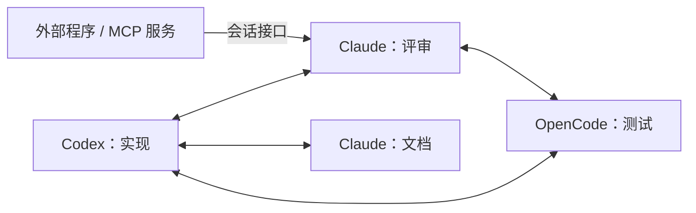

# Plexus

**本机 AI 编程会话的协作网络：不限客户端，自由拓扑。**

Plexus 把同一台电脑上的 AI 编程会话连成一张网：**Codex 桌面 App**、**VS Code 中的 Claude Code**、**OpenCode**，以及通过会话接口接入的**任意外部程序**。每个会话都有自己的地址，知道地址就能给它发消息。谁和谁协作、按什么结构协作，由你和 agent 决定；Plexus 不预设主从关系或固定流程。

协作发生在原生会话里：Codex 留在桌面 App，Claude 留在 VS Code，各自沿用原任务、上下文和模型配置。本地管理页集中显示多个项目的会话、消息、上下文用量与额度状态。上下文快满时，Plexus 按你设定的阈值完成交付、压缩和恢复，长任务可以跨越压缩继续协作。

**OpenCode 通信、上下文显示与自动维护已接入**：插件支持软/硬阈值的交付、原生压缩、恢复和条件继续，默认按会话关闭。启用方法、原生验证及并发边界见 [OpenCode 自动维护](docs/OPENCODE-MAINTENANCE.md)，安装与通信验收见 [OpenCode 接入](docs/OPENCODE.md)，桌面应用壳仍未验收。主动创建、加载会话方向已取消，见 [取消与收尾](docs/SESSION-LIFECYCLE-CANCELLED.md)。

> 本项目在 0.3.0 之前名为 **Cooperation**（仓库名 codex-claude-bridge）。从旧版升级见 [从 Cooperation 升级](#从-cooperation-升级)。

[快速部署](#快速部署) · [发送第一条消息](#发送第一条消息) · [配置-mcp](#配置-mcp) · [会话接口](#会话接口让外部程序唤醒会话) · [自动上下文维护](#自动上下文维护) · [常见问题](#常见问题)

## 核心特色

| 特色 | 带来的体验 |
| --- | --- |
| **不限客户端** | Codex、Claude Code、OpenCode 的会话使用同一种地址和消息格式互发。外部程序（脚本、MCP 服务、后台任务）通过[会话接口](#会话接口让外部程序唤醒会话)给指定会话发通知，在任务完成后唤醒它。 |
| **自由拓扑** | 任何会话都能给任何已知地址的会话发消息。一对一评审、一个协调者分派多个执行者、流水线逐级传递、多方互相讨论，都用同一套机制组织；增减成员不需要改动其他会话。 |
| **协作发生在已有原生会话中** | Codex 留在桌面 App，Claude 留在 VS Code；沿用原任务 ID、已有上下文和客户端模型配置。 |
| **消息可追溯** | 每条消息自动附带真实发送者的名称、地址和消息编号；管理页保存完整通信记录，投递结果如实标注已提交、接收端暂存、未送达或待核对。 |
| **一个工作台管理多个项目** | 按目录浏览会话，或将跨目录会话组成自定义项目；右侧集中查看成员、设置和通信。 |
| **长任务有完整的上下文交接流程** | 达到阈值后保存交付文档，取得回执，再原生压缩、加载上文、取得恢复回执；原本正在工作的任务才自动继续。 |
| **维护期间，协作消息有序等待** | 每个会话独立持有维护锁与持久队列，恢复后按先后顺序投递；服务重启后仍保留流程与队列。 |
| **额度恢复后接续原任务** | Codex、Claude 的已核实限额中断会定期查询额度，恢复并核对原轮次后提交一次继续请求。 |
| **轻量、本地运行** | Node.js 原生模块、SQLite、静态管理页，零 npm 运行依赖；状态只在变化时写盘；复用原客户端登录，无需另配模型 API Key。 |

用户决定参与者与分工，agent 交换工作成果，Plexus 传递消息、展示状态并执行获准的维护流程。几种常见组织方式：

- **评审**：一个会话实现功能，另一个会话审查方案与变更，意见直接发回原会话。
- **分派**：一个协调会话把子任务发给多个执行会话，各自完成后回报。
- **流水线**：实现 → 测试 → 文档，每个会话完成后把成果交给下一个。
- **唤醒**：长时间运行的脚本或 MCP 服务完成后，通过会话接口通知等待中的会话继续。



上图是逻辑上的连接。实际消息都经过本机的 Plexus 服务转发和记录，所以任意两个会话之间都能直接通信；每个会话有独立的持久队列，维护期间收到的消息按顺序等待。

## 快速部署

### 1. 准备环境并获取项目

当前部署与原生验收以 **Windows x64** 为基线。

| 需要准备 | 用途 |
| --- | --- |
| Node.js **22.13 或更新版本** | 运行本地服务、MCP 与 CLI；本项目已验证 Node.js 25.2.1。 |
| 已登录的 Codex 桌面 App（使用 Codex 时） | 使用已有 Codex 会话及本机发送桥。 |
| VS Code 与已登录的 Claude Code 扩展（使用 Claude 时） | 使用已有 Claude 会话。 |
| OpenCode（使用 OpenCode 时） | 安装方法见 [OpenCode 接入](docs/OPENCODE.md)。 |
| Windows .NET Framework C# 编译器 | 构建 Claude 接入程序；构建脚本会检查本机是否已有。 |
| Git，或下载后的源码 ZIP | 获取项目。 |

只需准备你要用的客户端；不用 Claude 时可以跳过下面的构建步骤。

```powershell
git clone https://github.com/Heisenbear-Rebirth/plexus.git Plexus
cd Plexus
node --version
.\scripts\build-claude-wrapper.ps1
```

无需运行 `npm install` 或构建前端。最后一步生成 `bin/claude-wrapper.exe` 和 `bin/claude-wrapper.paths`，其中包含本机路径；**移动项目或换机器后重新构建**。

下文统一以 `C:/Tools/Plexus` 为安装目录，请替换为你自己的完整路径。**工具安装目录**用于存放服务和数据；**工作项目目录**是 Codex、Claude 实际处理代码或文档的目录，两者可以不同。

### 2. 启动服务并连接 Codex

双击 **启动项目.cmd**，服务会在后台启动并打开管理页。重复启动会复用已有服务。管理页固定在 **http://127.0.0.1:47821**（IANA 未分配端口）；可用 `--port` 或环境变量 `PLEXUS_PORT` 改用其他端口，`0` 表示随机。若 47821 被其他程序占用，服务会改用随机端口并在管理页顶部提示，此时以打开的页面为准。

首次使用时，为 Codex 配置一次 [Plexus MCP](#配置-mcp)，重新连接该 MCP。页面右上角显示 **“Codex 已连接”** 后，即可向 Codex 发消息。只使用 CLI 时，也可以让 Codex 在自己的命令工具中运行一次：

```powershell
node "C:/Tools/Plexus/bin/plexus-service.mjs" start
```

工具会在本地保存已授权的连接，并在启动和发送前检查连通性。**以后正常双击启动即可，不再要求每次都从 Codex 会话启动。** 配好 MCP 后，Codex 重新接入时会自动更新连接，运行中的管理服务会自动重连，无需重启服务。

| 操作 | 入口与效果 |
| --- | --- |
| 打开或启动管理页 | 双击 `启动项目.cmd`；已有服务时直接打开，未运行时后台启动并恢复连接。 |
| 关闭服务 | 双击 `关闭项目.cmd`；正常关闭本项目管理进程并保留数据，Codex 和 Claude 原生会话继续运行。 |
| 在终端查看运行日志 | `node bin/plexus.mjs serve`（默认端口 47821）；保持终端运行，按 `Ctrl+C` 关闭。 |

Codex App 需要保持可用。断开时页面会显示“Codex 待连接”；打开 Codex 并连接 Plexus MCP 后，状态会自动更新。工具只复用本机已经取得的授权连接，投递结果不确定的消息仍需核对，不会自动重发。

### 3. 接入 Claude Code

在 VS Code 的用户设置 JSON 中，**合并下面这一项**，指向刚构建的文件：

```json
"claudeCode.claudeProcessWrapper": "C:\\Tools\\Plexus\\bin\\claude-wrapper.exe"
```

这是一项 **VS Code 用户级配置**，由你明确选择是否启用；构建和启动服务不会自动写入它。保留其他设置；已有其他 wrapper 时，先核对如何整合。该程序会启动扩展原本选定的 Claude，并转发其输入、输出和权限交互。

已接入 wrapper 的新进程会尝试显示 Plexus 的 peer 消息，并标注“Plexus 会话消息”。仅转换原生回显的界面副本，不向 Claude 重发、不打断当前工具。现有进程不会热更新；待工作结束后再正常重开面板。该功能已通过隔离协议测试及专用 Claude 会话的工作中投递测试，用户确认面板出现消息气泡；本次消息在原任务结束后被处理，不保证入队即刻显示。默认关闭重开时的自动历史补显，避免旧消息集中出现在对话末尾。新消息的实时显示保留，同一会话内同编号的实时/历史回放共用去重记录。重开后原生面板可能不再显示旧协作消息，可在 Plexus 管理页查看通信历史。历史补显仅可通过独立的 `peerHistoryVisibility: true` 或 `PLEXUS_PEER_HISTORY_VISIBILITY=1` 显式启用，仍会在末尾补回而非原位置；详见 [wrapper 说明](CLAUDE-WRAPPER.md)。若原生没有输出对应回显，不会凭传输提交结果补造已收到消息。设置启动环境变量 `PLEXUS_PEER_MESSAGE_VISIBILITY=0` 可关闭此功能；也可在项目 `.plexus/claude-wrapper/config.json` 中设置 `peerMessageVisibility: false`，在下次启动 wrapper 时生效。


随后在管理页：

1. 添加 Claude 实际工作的项目目录。
2. 打开目录旁的 **“项目设置”**，开启 **“Claude 控制接入”**。
3. 在当前任务结束后重启 Claude 连接，让它通过 wrapper 启动。若关闭面板后仍复用旧进程，重启对应的 VS Code 窗口。
4. 确认原面板的模型、思考强度与权限选项符合你的预期，并检查管理页是否显示连接状态。

“Claude 控制接入”覆盖项目的目录范围：勾选“包含子目录”后，子目录会话自动继承接入，无需逐个添加；取消勾选时撤回继承。单独设置过的子项目按更具体的设置处理。这个开关与会话的“自动管理”相互独立。

详细接入、协议说明与回滚步骤见 [Claude 原生控制接入](CLAUDE-WRAPPER.md)。

### 4. 找到要协作的会话

在管理页左上选择 **“目录项目”**，点击 **＋** 添加工作目录，按需开启 **“包含子目录”**。展开项目后直接显示会话，灰色客户端名称位于会话名称后。点击会话，在右侧点击 **“复制地址”**。

地址形如：

```text
codex://实现功能的会话:原生会话ID
claude://审查方案的会话:原生会话ID
opencode://复核测试的会话:原生会话ID
```

也可以使用短地址 `codex:会话ID`、`claude:会话ID` 或 `opencode:会话ID`。**接收方由你指定；发送者由工具自动识别。** OpenCode 的发送入口与插件配置见 [OpenCode 接入](docs/OPENCODE.md)。

会话被发现只代表它存在。先打开准备使用的原生会话；Codex 自动维护需要任务已在 App 中加载，Claude 接收和控制需要相应连接在线。

## 发送第一条消息

### 通过 CLI：无需先配置 MCP

把下面的提示发给 **Codex 发送方会话**，替换目标地址与正文：

```text
请通过 Plexus CLI 向以下目标会话实际发送消息，并告诉我投递结果：

node "C:/Tools/Plexus/bin/plexus.mjs" send --client codex --to "这里粘贴目标会话地址" --text "请审查我的实现方案，并通过 Plexus 把意见发回本会话。"
```

如果发送方是 **Claude Code**，把 `--client codex` 改为 `--client claude`。该参数表示**谁在发送**；`--to` 表示**发给谁**。

CLI 应由原会话的命令工具执行，以便取得该会话的身份。从独立 PowerShell 手工执行可能无法确认发送者。

长消息、代码片段或复杂引号内容适合先写入发送方获准目录内的 UTF-8 文本文件，再发送：

```powershell
node "C:/Tools/Plexus/bin/plexus.mjs" send --client claude --to "codex:目标会话ID" --file "E:/Work/MyProject/review.txt"
```

正文前会自动带上发送方地址。接收方可以用这个地址回信；是否回复、何时回复由任务要求和 agent 决定。

### 怎样确认第一次协作成功

1. 在目标原生会话中看到消息及发送方信息。
2. 在管理页选择相关会话，切换右侧 **“通信记录”**，找到同一条消息。
3. 让接收方回一条消息，并在原发送方会话中确认收到。

`submitted` 表示消息已提交到客户端通道；对方的回复或原生接收记录可用于核对处理进度。确认较慢时先返回 `pending`，服务在后台继续等待，状态会自动更新，无需重复发送。

Codex 投递确认最多等待两分钟。若仍为 `unknown`，服务会自动核对接收会话的原生记录；只有消息编号、完整正文和时间都匹配时，才确认送达并继续后续队列。没有匹配记录时保留未知状态，避免重复执行；此时仍可在消息详情核对处理。其他客户端的未知结果继续按各自的原生证据判断。

Claude 原生端可能暂存或拒收跨会话消息。发送适配器按实际发送方的权限模式生成声明；无法核实时，消息明确保留在本地队列。跨权限类别的接收由 Claude 原生设置决定：原生把 `bypassPermissions`（以及可切回绕过权限的 plan 模式）归为绕过类，`auto`、`default`、`acceptEdits`、`dontAsk` 均为需审批类，两类之间的消息会被暂存；VS Code 面板没有批准入口，到期（默认约 5 分钟）后过期。

管理页右上角 **“通信设置”** 提供 **“允许不同权限模式互发消息”** 开关，默认关闭。开启后，已允许 Claude 连接的会话由 wrapper 在其原生进程的会话级设置层写入 `crossSessionInbound: "accept"`，不再比较权限类别；关闭时移除该项，恢复原生规则。切换即时生效，不写入 Claude 的设置文件，也不冒用发送方的权限声明。托管策略设置的 `crossSessionInbound` 优先，项目设置只能收紧，对话框会显示各会话读回的实际生效情况。开启后，需审批模式的会话若读到被注入的内容，可借“绕过权限”的会话执行操作，只在信任全部协作会话时开启。该开关需要 wrapper 更新后重开过的 Claude 面板。

提交后服务会等待接收端的原生裁定（最多约 1.5 秒）：被暂存时发送方直接收到 `receiver_held`（接收端暂存）及原因，不再只返回 `submitted`；之后过期、拒收或丢弃时，通信记录自动改为 `undelivered`（未送达），MCP 与 CLI 按失败处理。已过期的消息不会自动重发，需统一双方权限模式或核对接收设置后明确重新发送。

### 给 agent 的协作约定

下面这段适合放在任务开头，或由你决定加入工作项目的指令文件：

```text
本任务允许通过 Plexus 与以下会话协作：
对方地址：<粘贴地址>
对方分工：<例如：审查方案、复核测试结果>

需要对方协助时，优先使用已加载的 Plexus send_message 工具；未加载 MCP 时使用本机 Plexus CLI。
发送时说明目标、必要背景、需要对方完成的事项和相关文件位置。
取得反馈后结合当前任务处理；需要回复时使用消息中附带的发送方地址。
发送后检查投递结果；结果不确定时先核对原会话。
```

Plexus 负责通信和上下文维护。任务分工、文件修改范围与结果验收由你和参与会话约定。

## 配置 MCP

CLI 和 MCP 都连接同一个管理服务。**配置 MCP 是让 agent 能直接调用工具；它不会替你启动管理服务或完成 Claude 接入。**

把配置放在**需要调用工具的工作项目**中，并把其中的安装路径替换为自己的路径。已有配置文件时合并相应条目。

### Codex

在工作项目的 `.codex/config.toml` 中加入以下配置；Codex 需要信任该项目才能加载项目级配置。配置位置和格式参见 [OpenAI MCP 文档](https://developers.openai.com/codex/mcp/)。

```toml
[mcp_servers.plexus]
command = "node"
args = ["C:/Tools/Plexus/bin/plexus.mjs", "mcp", "--client", "codex"]
tool_timeout_sec = 75
env_vars = ["CODEX_APP_TOOLS_PIPE_PATH", "CODEX_THREAD_ID", "CODEX_MCP_NODE_PATH"]
```

### Claude Code

在工作项目根目录的 `.mcp.json` 中合并以下配置。Claude Code 对项目级 MCP 的加载确认与连接检查见 [Claude Code MCP 文档](https://code.claude.com/docs/en/mcp)。

```json
{
  "mcpServers": {
    "plexus": {
      "command": "node",
      "args": ["C:/Tools/Plexus/bin/plexus.mjs", "mcp", "--client", "claude"]
    }
  }
}
```

重新加载对应客户端的 MCP 配置，完成客户端要求的信任或权限确认，并检查 `plexus` 是否已连接。配置样例也保存在 [Codex](examples/codex.config.toml) 与 [Claude](examples/claude.mcp.json) 文件中。

### 让会话调用 MCP

```text
请实际调用 Plexus MCP 的 send_message 工具：
to：<粘贴目标会话地址>
message：请审查刚才的方案，完成后通过 Plexus 回复本会话。

调用后告诉我投递结果。
```

本项目提供三个业务工具：

| 工具 | 参数 | 用途 |
| --- | --- | --- |
| `send_message` | `to`、`message` | 向指定会话发送消息。 |
| `context_checkpoint` | `cycleId`、`stage`、`receiptToken`、`documentPath` | 在收到维护请求后，确认交付或恢复阶段。 |
| `session_interface` | 无 | 取得本会话的[会话接口](#会话接口让外部程序唤醒会话)，交给外部程序在完成后唤醒本会话。 |

会话发现和通信历史由用户在管理页查看，agent 根据用户提供的地址工作。维护回执所需参数由系统下发，日常发消息只需使用 `send_message`。

## 会话接口：让外部程序唤醒会话

每个会话可以开启一个专用接口。外部程序（例如执行长任务的 MCP 服务、后台脚本）凭接口密钥向该会话发送消息；会话空闲时会被唤醒，工作中则按顺序排队。消息走普通协作通道，标注为“外部程序”，不是用户指令，也不能回复。

**取得接口**，任选其一：

- 管理页选中会话，点击 **“会话接口”** → **“开启接口”**，复制密钥或调用方式。这里也可以重置密钥（旧密钥立即失效）或停用接口。
- 让会话自己调用 MCP 工具 `session_interface`，或运行 `node "C:/Tools/Plexus/bin/plexus.mjs" hook --client claude`（Codex 用 `--client codex`）。适合让 agent 把自己的接口交给它启动的任务。

**调用接口**，推荐命令行；即使端口因占用而改变，命令行也会自动找到当前服务：

```powershell
node "C:/Tools/Plexus/bin/plexus.mjs" notify --hook <接口密钥> --source "训练任务" --text "训练已完成，结果在 out/report.md"
```

密钥也可放在环境变量 `PLEXUS_HOOK_KEY` 中；长内容用 `--file`。也可以直接发 HTTP，默认地址固定为 `http://127.0.0.1:47821`（端口被占用而改用其他端口时，以安装目录 `.plexus/connection.json` 的 `url` 为准），主机名必须是 `127.0.0.1`：

```text
POST http://127.0.0.1:47821/api/hooks/notify
Authorization: Bearer <接口密钥>
Content-Type: application/json

{"text":"训练已完成，结果在 out/report.md","source":"训练任务"}
```

返回值与 `send` 相同（`messageId`、`status`、`detail`）；`undelivered` 时 CLI 以非零退出。

- 一个会话只有一个接口；密钥只决定目标会话，请求里不能另指接收方。
- 每个接口每分钟最多 30 次调用；密钥错误、已重置或已停用的调用会被拒绝，不会进入任何会话。
- 外部程序没有权限类别，Claude 消息不附带权限声明。接收方是“绕过权限”模式时，需要在“通信设置”中开启“允许不同权限模式互发消息”，否则消息会被原生暂存后过期。
- 持有密钥即可向该会话发消息，只交给可信的程序。agent 不能重新启用用户停用的接口。OpenCode 会话请在管理页开启。

## 管理页怎么用

- **项目导航**：左侧抽屉显示可折叠项目与单行会话。Claude、Codex、OpenCode 以灰色名称跟在会话后，状态圆点提示连接与活动。搜索项目或会话，点击“已连接”筛选；左上导航按钮可收起侧栏。
- **项目概览**：点击项目名称，右侧展示成员与连接统计；点击成员进入其设置。目录旁的“···”可编辑项目名称、子目录范围和 Claude 控制接入。
- **会话设置**：右侧显示上下文占用、模型、活动状态和统计时间。自动管理使用开关，阈值可输入或拖动；失焦、按 Enter 或松开滑块后自动保存。关闭自动管理后继续观察用量，未知容量保持未知。
- **通信记录**：选择项目时显示涉及该项目成员的发送与接收，选择会话时聚焦该会话。消息支持关键词、状态筛选；点击消息阅读完整正文和投递结果。折叠导航不改变当前选中的通信范围。
- **连接与维护**：会话设置中保留连接帮助、刷新状态、维护接续与队列处理。OpenCode 的自动管理开关按原生插件维护能力开放。

### 自定义项目：按协作目标组织会话

1. 先在“目录项目”中添加会话来源目录。
2. 切换左上 **“自定义项目”**，点击 **＋**，填写组名并点击所需会话加入。可跨目录选择，也可按名称、目录或客户端搜索。
3. 保存后，组名成为左侧项目标题，下方只展示所选成员。使用“编辑分组”改名或调整成员。

同一会话可以出现在多个组中，并共享原来的会话设置。分组成员与名称保存在本地管理数据库，服务重启后保留；暂时离线或未发现的成员仍显示在组中。删除分组只移除组织关系，保留会话、策略和通信历史。多个窗口同时编辑时会核对版本，提示重新打开已被修改的分组。

页面采用浅灰侧栏、白色内容区与绿色操作强调，主要空间留给所选项目或会话。目录、消息列表和正文各自滚动；手机宽度下项目导航为覆盖式抽屉。长消息实时刷新保持阅读位置。管理页中的通信记录只包含经 Plexus 发送的消息。

## 自定义提示词

管理页右上角的 **提示词设置** 可编辑 Codex、Claude、OpenCode 消息前后缀、Claude 显示标签，以及交付、恢复、继续任务和额度恢复提示词。支持实时预览、插入变量、清空附加文字和恢复默认；修改后点击保存。设置覆盖此管理台的所有项目，普通消息在入队时固定配置，维护提示词从下一次发送起使用新内容。详见 [提示词设置](docs/PROMPT-SETTINGS.md)。

## 自动上下文维护

每个会话有独立的 **“自动管理”** 开关，**默认关闭**。先确认会话接入和通信正常，再按需启用。

| 客户端 | 空闲阈值 | 优先阈值 |
| --- | --- | --- |
| Codex | 40% | 55% |
| Claude Code | 50% | 80% |
| OpenCode | 50% | 80% |

空闲阈值表示：达到该占用后，等待当前工作结束再维护。优先阈值表示：工作过程中达到该占用，先中断对应轮次，再进行维护。数值可按会话修改；必须满足 `0 < 空闲阈值 < 优先阈值 < 100`。已启用时降低阈值可能立即触发维护。

### 一次维护会发生什么

```text
达到阈值 → 锁住 Plexus 入站消息 → 必要时中断原工作
    → 写交付文档 → handoff 回执 + 本轮结束
    → 原生压缩完成
    → 读取交付文档、加载上文 → restored 回执 + 本轮结束
    → 原本工作中才继续任务 → 按顺序投递排队消息
```

交付文档保存接续任务所必需的信息，比如当前进展、关键约束或容易遗漏的事项，具体内容和组织方式由 agent 判断；文档写入目标会话工作目录的 `.plexus/handoffs/`。两个回执都校验身份、阶段凭证与文档内容；普通回复 `OK` 不会推进流程。

工具使用原会话当前的模型、思考强度和权限设置。**三端均已取消思考强度和权限的前后一致性限制**：这些设置与压缩前记录不同，本身不会阻塞维护或回执；OpenCode 在发送前读取最新 variant。原生权限审批仍由客户端执行。

会话身份、模型/代理、原生轮次、交付文档和回执仍需核对。维护包含模型参与的交付与恢复轮次，会使用原客户端的正常用量。

### 额度不足与恢复

启用自动管理后，Codex 和 Claude 的已核实额度中断会保留原任务与排队消息，并定期查询实际额度。Codex 的账户额度独立于当前会话活动状态显示；窗口名称按返回的真实时长标注。

- **额度可用、原轮次仍对应**：核对会话状态后提交一次继续请求。
- **客户端未连接、存在待审批请求或未结束子任务**：保留任务并显示具体等待原因，额度查询继续进行。Codex 已结束的历史子任务不会阻塞接续。
- **额度查询失败或必要窗口缺失**：显示待查询或缺失信息，继续检测。
- **曾提交继续请求但结果未知**：保留记录，先核对原生结果。

服务重新启动后，先在管理页确认需要接续的会话，再按上述条件推进。确认只覆盖所选会话。OpenCode 的 HTTP 429 会暂停维护和消息投递；当前尚无统一额度查询，需要在原会话处理限流后继续。详见 [额度恢复](docs/QUOTA-RECOVERY.md) 与 [重启恢复](docs/RESTART-RECOVERY.md)。

### 回执遇到权限确认

Codex/Claude维护提示优先要求调用 `context_checkpoint`；未加载 MCP 时，会提供专用 CLI 命令。Claude 如果要求执行授权，可以按原权限流程批准。OpenCode使用插件工具 `plexus_context_checkpoint` 绑定原生身份，不使用CLI代填会话来源。

若希望在特定工作项目中允许该专用入口，可由你在该项目的 `.claude/settings.local.json` 中合并窄规则，例如：

```json
{
  "permissions": {
    "allow": [
      "Bash(node C:/Tools/Plexus/bin/plexus-checkpoint.mjs *)"
    ]
  }
}
```

保留已有权限条目，并使用实际安装路径。该许可只覆盖专用回执 CLI；工具不会自动安装这条规则。路径包含空格时，以维护提示实际生成的命令及客户端权限匹配结果为准。

### 流程显示“需要处理”时

卡片按当前阶段提供可执行操作：

- **检查并继续**：核对已有压缩、回执和原生轮次后接续。
- **按当前进度继续维护**：尚未提交压缩的暂停流程可重新保存最新进度，旧文档与回执保留。
- **重新保存进度并继续整理**：Claude 上次压缩已确认失败且没有压缩边界时，可在额度和会话就绪后重新接续。

当前回复、额度或连接状态暂不允许操作时，按钮旁会说明原因。取消维护可选择**保留待处理消息**或**发送待处理消息**；保留的消息维持先后顺序。

Claude 压缩接口的等待超时后，管理流程会在维护期限内继续核对同一个压缩请求；确认原生压缩完成且会话空闲后发送恢复提示。服务重启会保留锁与流程；先在前端弹窗确认待接续会话，再核对原生完成证据后续接。结果未知的消息或压缩不会自动重复执行。

### 客户端重连后的维护接续

客户端离线时，流程保留阶段、会话锁和 FIFO 队列。重新打开同一个原生会话后，管理器核对会话 ID、目录、模型/代理、文档哈希及原生历史，再接续能够确认的阶段；已接受的回执保留。

Codex、Claude 按恢复判据处理未完成提示；OpenCode 对已提交但没有回执的提示保留待处理状态，供核对后重试。新业务输入、文档变化或无法确认的压缩结果会暂停原流程。具体处理见 [重启恢复](docs/RESTART-RECOVERY.md)。

## 常见问题

| 现象 | 检查与处理 |
| --- | --- |
| 管理页能打开，但消息发不到 Codex | 查看右上角 Codex 连接状态，确认 Codex App 已打开、Plexus MCP 已连接，且配置中包含示例的三个 env_vars。已有服务会自动重连，无需反复关闭和启动。 |
| Codex 显示“未加载” | 在 Codex App 中打开这个已有任务，再检查状态。独立自动维护通道目前不自动唤醒未加载任务。 |
| Claude 能被发现，但接收或控制不可用 | 检查 wrapper 已构建、VS Code 配置路径正确、实际工作目录已允许“Claude 控制”，并重新打开面板。 |
| Claude 已连接，但提示接入需要更新 | 当前原生进程仍使用旧代码。任务结束后重启对应 Claude 连接；仅刷新管理页或切换面板不足以更新它。 |
| 额度可用却仍等待 | 查看会话就绪原因与本次启动的接续确认。待审批请求、未结束或无法核实的子任务仍会等待；已结束的历史子任务不应阻塞。 |
| Claude 消息显示“接收端暂存”或“未送达” | 核对双方权限模式是否同属绕过类或同属需审批类（例如一方 `auto`、另一方“绕过权限”会被暂存），或在“通信设置”中允许不同权限模式互发，或核对原生跨会话接收设置。OpenCode 更新发送权限声明功能后，需要重启原后端加载。 |
| 管理页没有消息 | 选择左侧项目或会话，打开“通信记录”，检查已连接、关键词与状态筛选；这里只展示经过本工具的通信。 |
| 会话说找不到 `send_message` | 确认 MCP 配置在该会话工作项目内且已加载；可以先用 CLI 发消息。 |
| CLI 报告无法识别当前会话 | 让 Codex 或 Claude 的原生命令工具执行；不要手工填写或伪造发送者环境变量。 |
| 配置了 MCP，却提示管理台未启动 | MCP 进程和管理服务是两个入口；先启动管理服务。 |
| 修改后没有自动压缩 | 确认卡片保存成功、开关已启用、统计可用且达到阈值；空闲阈值会等工作结束。 |
| 消息状态为 `unknown` | Codex 会自动核对完整的原生接收记录，确认后继续队列；没有可核实记录或其他客户端仍显示未知时，在原会话核对后从消息详情确认结果。不要新建重复消息。 |
| 移动项目后 Claude 接入失效 | 在新位置重新构建 wrapper，并更新 VS Code 与 MCP 中的绝对路径。 |
| 构建提示找不到 `node.exe` 或 C# 编译器 | 检查环境要求；脚本不会自动安装软件。 |
| PowerShell 阻止构建脚本执行 | 查看具体策略提示，按本机或组织规则允许所需脚本；无需为部署关闭全局安全策略。 |

## 数据、升级与使用范围

中央消息、策略、SQLite 数据库、流程与队列保存在**工具安装目录**的 `.plexus/`；交付文档保存在**目标工作项目**的 `.plexus/handoffs/`。服务日志是 `.plexus/service.stdout.log` 与 `.plexus/service.stderr.log`。

会话状态每隔几秒采样一次，但只有内容变化时才写入数据库并通知管理页；仅采样时间不同的结果只保存在内存中。Claude 面板或 OpenCode 后端被强制关闭时，来不及删除自己的注册文件；管理服务发现对应进程已退出后，会删除这些文件。所有 Codex 会话共用一条到 Codex 的连接；Codex 历史库没有变化时，会话发现直接沿用上次的结果。会话已不存在（例如记录被删除）而自动管理仍开启时，每分钟才重新查找一次；不再需要时，可在管理页关闭它的自动管理。

备份前先正常关闭管理服务。备份工具的数据目录；需要保留上下文交接文件时，同时备份相应工作项目的 handoffs 目录。连接记录、保存的 Codex 桥连接和 wrapper 注册文件含本机连接信息，不应随源码公开。项目的 `.gitignore` 已排除中央运行数据、机器相关构建产物和本机验收记录。

从旧版升级时，服务会备份并导入旧 `messages.jsonl`，保留原文件。升级后以 SQLite 为写入来源；若旧日志随后被改动，启动会要求核对，避免形成两个不一致的数据来源。

### 从 Cooperation 升级

0.3.0 起项目更名为 Plexus，命令、MCP 名称、数据目录和环境变量随之更改：

| 旧名称 | 新名称 |
| --- | --- |
| `bin/coop.mjs`（命令 `coop`）、`bin/coop-*.mjs` | `bin/plexus.mjs`（命令 `plexus`）、`bin/plexus-*.mjs` |
| MCP 服务名 `cooperation`（Claude 工具前缀 `mcp__cooperation__`） | `plexus`（`mcp__plexus__`） |
| OpenCode 插件工具 `cooperation_*` | `plexus_*` |
| 数据目录 `.cooperation/` | `.plexus/` |
| 环境变量 `COOP_*` | `PLEXUS_*` |
| Claude 消息标签 `【Cooperation 会话消息】` | `【Plexus 会话消息】` |

升级步骤：

1. 双击“关闭项目”停止服务。更新代码后的关闭脚本也能识别并停止旧版服务。
2. 更新代码，重新运行 `.\scripts\build-claude-wrapper.ps1`。
3. 双击“启动项目”。首次启动时，安装目录的 `.cooperation/` 自动迁移为 `.plexus/`；`.plexus/` 中已有同名项时保留旧项，并在管理页提示。提示词设置中仍是旧默认标签的部分改为新标签，你自己写的内容不变。
4. 在 Codex、Claude Code、OpenCode 的配置中，把 MCP 服务名改为 `plexus`，命令改为 `bin/plexus.mjs`，再重新加载 MCP 连接。Claude 的权限规则若写了 `mcp__cooperation__…` 或 `coop-checkpoint.mjs`，一并更新。
5. 在任务结束后重新打开 Claude 面板、重启 OpenCode 后端，加载新版 wrapper 与插件。

工作项目中已有的交付文档留在原来的 `.cooperation/handoffs/`，新的交付文档写入 `.plexus/handoffs/`。如果工作项目的 `.gitignore` 忽略了 `.cooperation/`，请同样忽略 `.plexus/`。

### 更新代码后如何生效

| 更新位置 | 加载方式 |
| --- | --- |
| 管理服务 | 正常关闭并重新启动 Plexus；按弹窗选择需要接续的会话。 |
| 管理页 | 完整刷新浏览器页面。已加载新版页面后，“更新状态”和服务重连还会更新维护提示规则，并保留未保存的提示词草稿。 |
| Claude wrapper | 任务结束后重启对应的 Claude 连接；若仍复用旧进程，重启对应 VS Code 窗口。 |
| OpenCode 插件 | 任务结束后重启原 OpenCode 后端，加载新的通信与维护逻辑。 |

只更新 Plexus 管理端通常无需重启 Codex App。修改 MCP 配置时，仍需重新加载对应客户端的 MCP 连接。

当前支持同一台 Windows 机器上的会话协作。Plexus 的维护锁覆盖本工具入口；原生界面出现新输入时，旧流程会暂停核对。活动 goal、未结束或无法核实的子任务和后台任务暂不开放自动维护；Codex 中有明确结束记录的历史子任务不受此限制。

本地原生控制依赖客户端接口。客户端升级后，应先核对连接、消息和维护行为；各版本的实际验收记录见 [验证范围](docs/VALIDATION.md)。

## 验证与进一步阅读

在仓库根目录执行：

```powershell
.\scripts\build-claude-wrapper.ps1
node --test test/*.test.mjs
```

截至 **2026-11-10**，完整自动检查共 **458 项，457 项通过**。未通过的一项是启动脚本测试：在中文代码页下，cmd 无法解析中文脚本文件名，与功能无关。回归覆盖子目录接入继承与撤回、重连与额度接续、取消与新输入竞态、未知投递的原生回执核对、原生暂存与过期的回传、会话接口、空闲时的资源占用、更名后的数据迁移、大会话快照、两阶段回执、一次压缩、FIFO，以及思考强度和权限变化后继承当前设置。

Codex、Claude 和 OpenCode 均有软/硬维护的原生验收记录；浏览器检查覆盖状态反馈、继续操作、消息队列及 390px 布局。版本、原生异常和恢复过程分别保存在 [验证范围](docs/VALIDATION.md)，本地原始日志不随源码发布。

| 文档 | 内容 |
| --- | --- |
| [验证范围](docs/VALIDATION.md) | 自动测试、原生验收与当前边界。 |
| [Claude 原生接入](CLAUDE-WRAPPER.md) | wrapper 构建、设置、协议与回滚。 |
| [OpenCode 自动维护](docs/OPENCODE-MAINTENANCE.md) | 原生插件、回执、压缩与接续。 |
| [重启恢复](docs/RESTART-RECOVERY.md) | 接续确认、离线、额度与不同启动顺序。 |
| [设置一致性限制调整](docs/SETTINGS-UNLOCK-2026-10-08.md) | 三端沿用当前思考强度与权限设置，以及消息声明修复。 |
| [Codex 历史子任务修复](docs/CODEX-HISTORICAL-AGENTS-2026-10-08.md) | 区分已结束的历史记录与仍待核实的工作。 |
| [自动上下文设计](docs/AUTO-CONTEXT-DESIGN.md) | 会话状态、阈值与维护流程的设计依据。 |
| [实现计划](docs/AUTO-CONTEXT-IMPLEMENTATION-PLAN.md) | 分阶段实现与验收路径。 |
